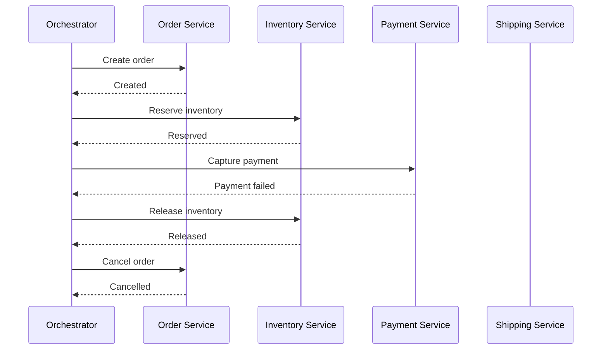

# Saga Pattern

The **Saga Pattern** coordinates a business operation that spans multiple services or data stores as a sequence of **local transactions**. If a later step fails, earlier completed steps are handled through retries or **compensating actions** rather than one global database rollback.

> **Key point:** A saga is not one distributed ACID transaction. Each participant commits locally, intermediate states can become visible, and failures are handled explicitly through continuation or compensation.

**Related:** [Transactional Outbox Pattern](../transactional-outbox.md) · [Idempotency](../../architecture/idempotency.md) · [Atomicity and Atomic Operations](../../databases/atomicity.md) · [Transaction Isolation](../../concepts/concurrency/isolation.md)

## Contents

- [The Problem](#the-problem)
- [How a Saga Works](#how-a-saga-works)
- [Compensation Is Not Rollback](#compensation-is-not-rollback)
- [Choreography](#choreography)
- [Orchestration](#orchestration)
- [Example: Order Workflow](#example-order-workflow)
- [Failure Handling](#failure-handling)
- [Isolation and Concurrent Sagas](#isolation-and-concurrent-sagas)
- [Outbox and Idempotency](#outbox-and-idempotency)
- [When to Use It](#when-to-use-it)
- [When Not to Use It](#when-not-to-use-it)
- [Common Mistakes](#common-mistakes)
- [Key Takeaways](#key-takeaways)
- [Useful Links](#useful-links)

---

## The Problem

Inside one database, a transaction can make several changes atomically:

```text
BEGIN
update A
update B
update C
COMMIT
```

But a business workflow might span independent systems:

```text
Order Service
↓
Inventory Service
↓
Payment Service
↓
Shipping Service
```

There may be no shared transaction manager that can atomically commit all four systems.

If inventory succeeds and payment later fails, simply rolling back one database transaction is no longer possible because inventory already committed in another service.

A saga models this failure explicitly.

---

## How a Saga Works

A saga is a sequence of local transactions:

```text
T1 -> T2 -> T3 -> T4
```

Each transaction commits in its own service/database.

If all steps succeed:

```text
T1 ✓ -> T2 ✓ -> T3 ✓ -> T4 ✓
```

If a later step fails, the workflow runs compensating actions for earlier work where appropriate:

```text
T1 ✓ -> T2 ✓ -> T3 ✗
              ↓
        C2 <- C1
```

Where:

- `T1`, `T2`, `T3` are forward transactions;
- `C1`, `C2` are compensating actions.

A saga can also use **forward recovery**: retry a failed step until it succeeds when the failure is transient and retrying is valid.

---

## Compensation Is Not Rollback

This distinction is essential.

A database rollback makes it as though the transaction never committed.

A saga compensation is a **new business operation** that attempts to counteract an earlier committed operation.

Example:

```text
Forward step:       charge customer 50 EUR
Compensation:       refund customer 50 EUR
```

The charge still happened. A refund is a separate event with its own timestamps, fees, audit trail, possible failure, and external effects.

Other examples:

| Forward action | Possible compensation |
| --- | --- |
| Reserve stock | Release reservation |
| Create booking | Cancel booking |
| Authorize payment | Void authorization |
| Capture payment | Refund payment |
| Create shipment | Cancel shipment if still possible |

Some actions are not fully reversible. A sent email cannot be unsent. A shipped parcel may be too late to cancel. Saga design therefore depends on **business semantics**, not just technical transactions.

---

## Choreography

With **choreography**, there is no central saga coordinator. Services react to events and publish new events.

```text
OrderPlaced
    ↓
Inventory Service reserves stock
    ↓
InventoryReserved
    ↓
Payment Service charges customer
    ↓
PaymentCaptured
    ↓
Shipping Service creates shipment
```

If payment fails:

```text
PaymentFailed
    ↓
Inventory Service releases stock
    ↓
Order Service marks order cancelled
```

### Advantages

- participants stay relatively autonomous;
- no central workflow service is required;
- works naturally in event-driven systems;
- can be simple with only a few participants.

### Costs

- the workflow becomes spread across many services;
- understanding the complete flow can become difficult;
- cyclic event dependencies are easier to create;
- global timeout/retry rules are harder to manage consistently;
- observability becomes essential.

Choreography tends to work best for smaller, naturally event-driven workflows.

---

## Orchestration

With **orchestration**, one component owns the workflow state and explicitly tells participants what to do.

```text
Saga Orchestrator
  ├─> Inventory: reserve
  ├─> Payment: charge
  └─> Shipping: create shipment
```

If payment fails:

```text
Saga Orchestrator
  ├─> Inventory: release reservation
  └─> Order: cancel
```

### Advantages

- workflow logic is visible in one place;
- easier to understand long or branching workflows;
- centralized retries, timeouts, compensation, and observability;
- participant services need less knowledge about the overall process.

### Costs

- introduces a coordinator that must be reliable;
- workflow logic can become concentrated in the orchestrator;
- careless designs can couple the orchestrator too tightly to participant internals.

Orchestration is often easier to reason about when a saga has many steps or complex branching rules.

---

## Example: Order Workflow

Consider:

```text
1. Create order
2. Reserve inventory
3. Capture payment
4. Create shipment
```

A simplified orchestration flow:



The system reaches a valid business outcome without pretending that all services participated in one transaction.

---

## Failure Handling

Saga steps need an explicit failure policy.

### Transient Failure

Example: temporary network outage.

Possible response:

```text
retry with backoff
```

Retries should be bounded or governed by a policy, and the operation should be idempotent.

### Business Failure

Example: card declined.

Retrying the exact same operation may be pointless. The saga normally enters a compensating path.

### Compensation Failure

Compensation can fail too.

```text
Payment failed
↓
Try to release inventory
↓
Inventory service unavailable
```

The saga must preserve its state and retry/reconcile until a valid end state is reached or requires manual intervention.

### Unknown Outcome

A timeout does not necessarily mean failure:

```text
request sent
↓
participant completes operation
↓
response is lost
```

The coordinator cannot safely assume the step did not happen. Stable operation IDs/idempotency keys are critical.

---

## Isolation and Concurrent Sagas

Sagas do not provide the isolation of one ACID database transaction.

Intermediate committed states can be visible while the saga is still running:

```text
inventory reserved
payment not yet captured
order not yet confirmed
```

Another workflow may observe or act on that state.

Possible techniques include:

- semantic states such as `pending`, `reserved`, or `cancelling`;
- conditional updates and version checks;
- optimistic/pessimistic concurrency control inside each participant;
- business-level reservations;
- rereading state before critical decisions;
- designing operations that commute safely when possible.

A saga solves distributed workflow consistency, not general transaction isolation.

---

## Outbox and Idempotency

Sagas often depend on reliable messaging.

If a participant needs to update its database **and** publish the event that advances the saga, it has a dual-write problem.

Use the [Transactional Outbox Pattern](../transactional-outbox.md) so the local state change and the intention to publish are committed together.

Because messages, retries, coordinator commands, and compensation steps can be delivered more than once, saga participants should also be [idempotent](../../architecture/idempotency.md).

A useful reliability model is:

```text
Local step
    -> atomic inside its own database

Messages/commands
    -> at-least-once + idempotent handling

Cross-service workflow
    -> saga state + retry + compensation
```

---

## When to Use It

Consider a saga when:

- one business workflow spans multiple independently committed services/data stores;
- a single ACID transaction cannot cover all participants;
- eventual consistency is acceptable;
- the business can define compensation or another valid recovery path;
- the workflow may be long-running.

Common examples:

- orders, inventory, payments, and shipping;
- bookings across independent systems;
- account onboarding across several services;
- provisioning workflows;
- multi-step approval/business processes.

---

## When Not to Use It

Do not introduce a saga merely because an operation has several steps.

Prefer a normal database transaction when all required data can reasonably live inside the same transactional boundary.

A saga may also be a poor fit when:

- the business requires immediate strong consistency across every step;
- meaningful compensation does not exist;
- the complexity of asynchronous recovery is not justified;
- splitting the workflow across services created an unnecessary distributed transaction in the first place.

Sometimes the best solution is to change the service/data boundary rather than add a distributed pattern.

---

## Common Mistakes

- **Treating compensation as a perfect rollback.** Compensation is a new business action and can fail.
- **Making steps non-idempotent.** Retries and duplicate delivery are normal.
- **Publishing events directly after a database commit without an outbox.** This recreates the dual-write problem.
- **Ignoring intermediate states.** Other workflows can observe partially completed sagas.
- **Using choreography for a large workflow without observability.** The flow becomes difficult to trace and debug.
- **Building an orchestrator with no durable state.** A coordinator crash must not forget which steps completed.
- **No manual recovery path.** Some failures eventually require operator intervention.

---

## Key Takeaways

- A saga is a sequence of **local transactions**, not one distributed ACID transaction.
- Failure handling uses retries, forward recovery, and compensating business actions.
- Compensation is not the same as rollback.
- Choreography distributes workflow logic through events; orchestration centralizes coordination.
- Sagas are eventually consistent and do not provide normal transaction isolation across services.
- Reliable saga implementations usually need idempotency, durable workflow state, observability, and often Transactional Outbox.

---

## Useful Links

- [AWS Prescriptive Guidance: Saga patterns](https://docs.aws.amazon.com/prescriptive-guidance/latest/cloud-design-patterns/saga-patterns.html)
- [AWS Prescriptive Guidance: Saga pattern](https://docs.aws.amazon.com/prescriptive-guidance/latest/modernization-data-persistence/saga-pattern.html)
- [Azure Architecture Center: Saga pattern](https://learn.microsoft.com/azure/architecture/patterns/saga)
