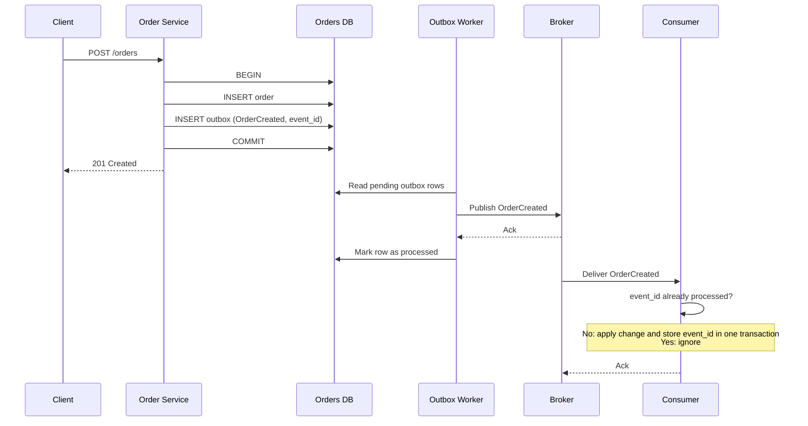

# Transactional Outbox Pattern

A pattern for reliably publishing events when a service changes its database, without losing events and without distributed transactions.

> **Key point:** The Transactional Outbox prevents events from being lost because of the database/message-broker dual-write problem, but consumers still need to tolerate duplicate delivery.

## Contents

* [The Problem: Dual Writes](#the-problem-dual-writes)
* [The Transactional Outbox](#the-transactional-outbox)
* [How It Works](#how-it-works)
* [Delivery Semantics](#delivery-semantics)
* [Why the Outbox Usually Means At-Least-Once](#why-the-outbox-usually-means-at-least-once)
* [Duplicate Events](#duplicate-events)
* [Consumer Idempotency](#consumer-idempotency)
* [Event IDs and Deduplication](#event-ids-and-deduplication)
* [External Side Effects](#external-side-effects)
* [Idempotency Keys](#idempotency-keys)
* [Example Flow](#example-flow)
* [Failure Scenarios](#failure-scenarios)
* [Key Takeaways](#key-takeaways)

---

## The Problem: Dual Writes

A service often needs to do two things for one business operation:

1. update its database;
2. publish an event to a broker (Kafka, RabbitMQ, SQS, ...).

The database and the broker are **independent systems**. There is no shared transaction covering both, so one write can succeed while the other fails. This is the **dual-write problem**.

```text
saveToDatabase();
publishEvent();
```

This code is not atomic. The process can crash, or the network can fail, between the two lines:

```text
Database update succeeds
↓
Application crashes
↓
Message is never published
```

The order exists, but no other service ever hears about it.

Reversing the order only reverses the failure:

```text
Message is published
↓
Database transaction fails
```

Now other services react to an order that does not exist.

Things that do not fix it:

* **Publishing inside the database transaction.** The broker does not take part in the transaction. If the commit fails after the publish, the event is already out.
* **Retrying the publish in memory.** The retry state is lost if the process crashes.
* **try/catch with a compensating write.** The compensation is itself another write that can fail.

---

## The Transactional Outbox

Instead of writing to two systems, write to **one**: the database.

The event is stored in an `outbox` table **in the same transaction** as the business change:

```text
BEGIN TRANSACTION

Update business data
Insert event into outbox table

COMMIT
```

Either both rows are committed or neither is. The state change and the *intention to publish* are now atomic.

Publishing to the broker happens later, asynchronously, by a separate process that reads the outbox.

A conceptual outbox table:

```text
id            Row identifier (often sequential, useful for ordering)
event_id      Unique ID of the event, generated once, when the row is written
event_type    e.g. OrderCreated
payload       Serialized event data
status        pending / processed
created_at    When the event was recorded
processed_at  When it was published
```

---

## How It Works

1. The application commits business data and an outbox row in one transaction.
2. A **relay** (outbox worker) reads pending outbox rows.
3. The relay publishes each event to the broker.
4. After the broker acknowledges, the relay marks the row as processed.
5. If anything fails, the row stays pending and is retried.

Two common ways to implement the relay:

* **Polling publisher** – a worker queries the table periodically for pending rows. Simple, works with any database.
* **Transaction log tailing (CDC)** – a tool such as Debezium reads the database log and forwards outbox inserts. Lower latency and no polling load, but more infrastructure.

Practical notes:

* The `event_id` must be created when the outbox row is written, **not** when publishing. Every retry must carry the same ID.
* With multiple workers, rows need to be claimed safely (for example `SELECT ... FOR UPDATE SKIP LOCKED`) to limit concurrent publishing of the same row.
* Retries and parallel workers can break ordering. If order matters, publish per aggregate in sequence and/or let consumers detect stale events with a version number.
* Processed rows should be cleaned up or archived, otherwise the table grows forever.

---

## Delivery Semantics

### At-Most-Once

A message may be lost, but is not processed more than once. Send it and never retry. Acceptable for metrics or logs, usually not for business events.

### At-Least-Once

A message is not lost, but may be delivered more than once. The sender retries until it gets an acknowledgement. This is what the outbox provides.

### Exactly-Once

The **observable business effect** happens once.

This is difficult because delivery itself cannot be made exactly-once across independent systems: when an acknowledgement is lost, the sender cannot tell "not received" from "received, but the reply was lost". It must either retry (risking a duplicate) or give up (risking a loss).

In practice:

```text
exactly-once effect  =  at-least-once delivery  +  idempotent processing
```

Broker features called "exactly-once" (for example Kafka transactions) apply **inside the broker's own boundary**: reading, processing and writing within Kafka. They do not cover your database, an email provider, or a payment API. A broker cannot guarantee exactly-once for a complete distributed business operation.

---

## Why the Outbox Usually Means At-Least-Once

The relay itself performs a dual write: publish to the broker, then update the outbox row. It solves this in the only safe direction: **retry until confirmed**.

```text
Outbox worker reads event
↓
Worker publishes event to Kafka
↓
Kafka accepts the event
↓
Worker tries to mark the outbox record as processed
↓
Database is unavailable
```

The outbox record remains pending. When the worker retries, **the same event is published again**.

This is expected behaviour, not a bug. Marking the row as processed *before* publishing would avoid the duplicate, but a crash in between would lose the event, which is the original problem.

> **The trade-off:** losing an event is replaced by the manageable possibility of processing a duplicate event.

---

## Duplicate Events

Duplicates can come from several places, not only the relay:

* the relay publishes but fails to mark the row as processed;
* the relay times out waiting for the broker's acknowledgement and retries;
* two relay instances pick up the same row;
* the consumer processes a message but crashes before acknowledging it (or committing its offset);
* the broker redelivers after a rebalance or a visibility timeout.

Duplicates are a normal property of the system. The consumer has to handle them.

---

## Consumer Idempotency

An operation is **idempotent** if applying it several times has the same effect as applying it once.

Some operations are naturally idempotent:

```text
SET status = 'paid'               idempotent
INSERT ... ON CONFLICT DO NOTHING idempotent
balance = balance + 100           NOT idempotent
INSERT a new row every time       NOT idempotent
```

Prefer naturally idempotent operations where possible (set absolute values, upsert by a business key). When that is not possible, deduplicate explicitly.

---

## Event IDs and Deduplication

Every event carries a unique `event_id`. The consumer records which IDs it has already processed.

```text
BEGIN TRANSACTION

Check if event_id was already processed

If yes:
    ignore event

If no:
    execute business operation
    store event_id as processed

COMMIT
```

The business change and the `event_id` record must be in the **same database transaction**. Otherwise the consumer has its own dual write:

* business change committed, `event_id` not stored → the retry applies the change **twice**;
* `event_id` stored, business change not committed → the retry is ignored and the change is **lost**.

In one transaction, both happen or neither does.

Practical notes:

* Put a **unique constraint** on `event_id`. Check-then-insert alone is not safe when two consumers handle the same event concurrently; the constraint makes the second one fail and roll back.
* The processed-events table (sometimes called an **inbox**) needs a retention policy. Keep IDs longer than the longest possible redelivery window.
* Acknowledge the message only **after** the commit.

---

## External Side Effects

Event-ID deduplication works because the business change and the dedup record share one database transaction. That stops working when the consumer does something **outside** its database:

* sending an email;
* calling an external API;
* charging a payment;
* issuing an invoice;
* calling another service.

```text
Send email successfully
↓
Application crashes
↓
event_id is never stored as processed
↓
Message is retried
↓
Email may be sent again
```

This is **another dual-write problem**: the external call and the local transaction cannot be made atomic. Storing the `event_id` first just flips the failure: the ID is recorded, the process crashes, and the email is never sent.

There is no universal solution. What helps depends on the operation:

* **Idempotency keys** – send a stable key with the request so the receiver deduplicates (see below).
* **Provider-supported idempotency** – many payment and messaging APIs accept such a key natively. Use it when available.
* **Deduplication on the receiving side** – if you own the other service, make it record the request or event IDs it has handled.
* **Additional outbox/inbox steps** – commit the *intention* (for example "email to send") in the local transaction, and let a separate worker perform the call with retries. This narrows the problem to a single call that must be idempotent; it does not remove it.
* **Naturally idempotent operations** – prefer `PUT`-style "set state to X" over "do X again".
* **Reconciliation** – periodically compare your state with the external system and fix differences. Often the last line of defence for payments.

For some operations (a plain email through a provider with no idempotency support) a rare duplicate may simply be accepted. That is a business decision; make it deliberately.

---

## Idempotency Keys

An idempotency key is a unique value sent with a request so the receiver can recognise retries of the **same** operation.

```text
POST /charges
Idempotency-Key: order-1042-payment

First request   → charge is executed, result stored under the key
Retried request → no new charge, stored result is returned
```

Rules:

* The key must be **stable across retries**. Derive it from the `event_id` or a business identifier. Never generate a new random key per attempt.
* The key identifies one logical operation. Different operations need different keys.
* The receiver must store the key and perform the operation atomically, which is the same idea as the consumer's processed-events table.
* Providers usually keep keys for a limited time. Retries after that window are treated as new requests.

Idempotency keys are the same concept as event-ID deduplication, applied at an API boundary: the *caller* supplies the identity, the *receiver* deduplicates.

---

## Example Flow

`POST /orders` creates an order and must publish `OrderCreated`.



Step by step:

1. The service inserts the order.
2. In the same transaction, it inserts an `OrderCreated` row into the outbox with a new `event_id`.
3. The transaction commits. The client gets its response; nothing has been published yet.
4. The outbox worker reads the pending row.
5. The worker publishes `OrderCreated` to the broker.
6. After the broker's acknowledgement, the worker marks the row as processed.
7. The consumer receives the event.
8. The consumer checks the `event_id`, applies its change and stores the ID in one transaction, or ignores the event if the ID is already known.

---

## Failure Scenarios

| Failure | Result | Handled by |
| --- | --- | --- |
| Service crashes before commit | No order, no outbox row. Nothing happened. | Database transaction |
| Service crashes after commit | Order and outbox row both exist. Event is published later. | Outbox worker |
| Broker is down | Row stays pending. Publishing is delayed, not lost. | Worker retry |
| Worker crashes before publishing | Row stays pending and is picked up again. | Worker retry |
| Worker publishes, then fails to mark the row as processed | Event is published **again**. | Consumer deduplication |
| Consumer crashes before its commit | Nothing was applied. Event is redelivered. | Broker redelivery |
| Consumer commits, then crashes before acknowledging | Event is redelivered and ignored. | Consumer deduplication |
| Consumer performs an external call, then crashes before its commit | External call may happen **again**. | Idempotency keys, reconciliation |

---

## Key Takeaways

* Writing to a database and a broker separately is a **dual write**. It cannot be made atomic by ordering the calls or by retrying in memory.
* The outbox turns it into a **single local transaction**: business data and the event are committed together.
* A separate relay publishes the events, retrying until the broker confirms.
* The result is **at-least-once delivery**: events are not lost, but duplicates are expected.
* Consumers must be **idempotent**, typically by storing processed `event_id`s in the same transaction as the business change.
* Deduplication in the database does **not** cover external side effects. Those need idempotency keys, provider support, reconciliation, or an accepted risk.
* "Exactly-once" in practice means **at-least-once delivery plus idempotent processing**, not a guarantee the broker gives for the whole operation.
* Costs of the pattern: events are published with a delay (eventual consistency), and there is a relay and an outbox table to operate and monitor.
